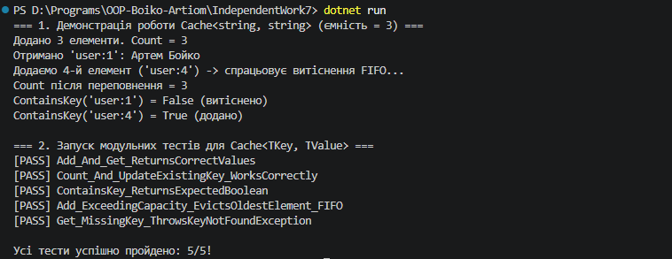

## Висновок

Під час виконання самостійної роботи було розроблено та протестовано узагальнений клас кешу `Cache<TKey, TValue>` з обмеженою ємністю та політикою витіснення найстаріших елементів FIFO (First In, First Out) у середовищі .NET SDK.

У межах роботи було реалізовано:
* **Узагальнений клас `Cache<TKey, TValue>`** на основі поєднання `Dictionary<TKey, TValue>` (для швидкого пошуку значень за ключем) та `Queue<TKey>` (для збереження суворого порядку додавання ключів і витіснення найстарішого запису при переповненні).
* **Контрольовану обробку відсутніх ключів** у методі `Get` через `TryGetValue` з викиданням `KeyNotFoundException`, а також оновлення значення для вже існуючого ключа без збільшення черги.
* **Модульні тести**, що перевіряють додавання й отримання елементів, властивість `Count`, метод `ContainsKey`, генерацію `KeyNotFoundException` та коректність витіснення найстарішого елемента за алгоритмом FIFO.

