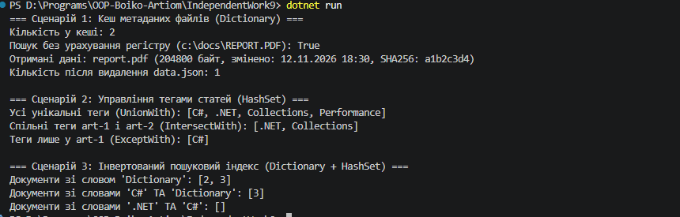

## Висновок

Під час виконання самостійної роботи №9 було досліджено внутрішню будову та реальні сценарії застосування узагальнених хеш-колекцій `Dictionary<TKey, TValue>` і `HashSet<T>` у популярних open-source бібліотеках .NET (Dapper, System.Text.Json, Newtonsoft.Json), а також реалізовано три практичні компоненти на C# (.NET SDK):

* **`FileMetadataCache` (`Dictionary<string, FileMetadata>`)** — кеш метаданих файлів із доступом за ключем за час $O(1)$ та підтримкою регістронезалежного порівняння шляхів через `StringComparer.OrdinalIgnoreCase`.
* **`TagManager` (`Dictionary<string, HashSet<string>>`)** — менеджер унікальних тегів статей із використанням теоретико-множинних операцій `UnionWith`, `IntersectWith` та `ExceptWith`.
* **`SearchIndex` (`Dictionary<string, HashSet<int>>`)** — інвертований пошуковий індекс, який забезпечує миттєвий пошук документів за окремим словом та перетин множин документів при пошуку за кількома ключовими словами.

Детальний аналіз open-source прикладів та порівняльна таблиця складності операцій наведені у файлі [`REPORT.md`](REPORT.md).

