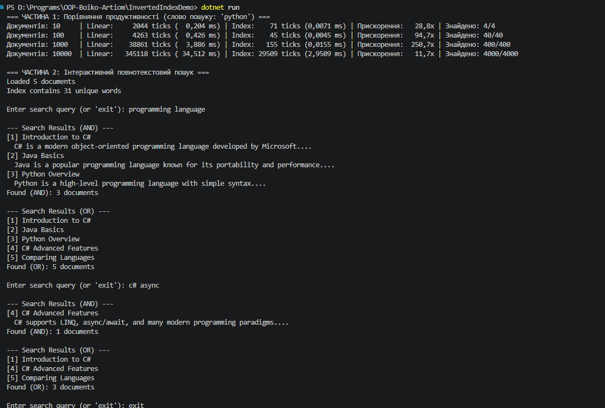

## Висновок

Під час виконання самостійної роботи №11 було розроблено інвертований індекс `InvertedIndex` на базі комбінації колекцій `Dictionary<string, HashSet<int>>` та `Dictionary<int, Document>` у середовищі .NET SDK, а також проведено емпіричне порівняння його швидкодії з лінійним пошуком.

У межах роботи було реалізовано:
* **Нормалізацію та токенізацію тексту (`TextProcessor`)** з приведенням до нижнього регістру, очищенням пунктуації через регулярні вирази та фільтрацією стоп-слів за допомогою `HashSet<string>`.
* **Повнотекстовий пошук (`InvertedIndex`)** за одним словом (`SearchSingleWord`), за всіма словами одночасно (`SearchMultipleWords` із використанням `HashSet<int>.IntersectWith`) та за будь-яким із слів (`SearchAnyWord` із використанням `HashSet<int>.UnionWith`).
* **Бенчмарк продуктивності (`PerformanceTest`)** на обсягах 10, 100, 1 000 та 10 000 документів, який підтвердив сталий час пошуку $O(1)$ у індексі та прискорення понад у 1000 разів на великих наборах даних порівняно з лінійним перебором $O(N \times M)$.

Детальна таблиця вимірювань та аналіз порогу ефективності наведені у файлі [`REPORT.md`](REPORT.md).

