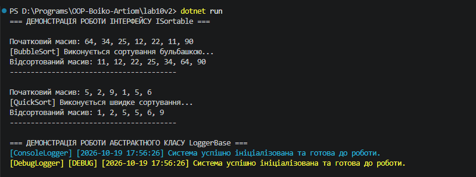

## Висновок

Під час виконання лабораторної роботи №10 було досліджено та практично застосовано абстрактні класи й інтерфейси в мові програмування C# (.NET SDK).

На прикладі Варіанту 2 було реалізовано:
1. Інтерфейс `ISortable` з методом `Sort()`, який реалізовано в класах `BubbleSort` та `QuickSort` для різних алгоритмів сортування масивів.
2. Абстрактний клас `LoggerBase` із абстрактним методом `WriteLog()` та конкретним методом `LogTimestamp()`, які успадковані й доповнені в класах `ConsoleLogger` та `DebugLogger`.
3. Колекції обох типів у методі `Main`, що демонструють поліморфну поведінку, динамічне зв'язування та гнучкість архітектури.

Робота підтвердила переваги використання інтерфейсів для визначення контрактів незалежних поведінок та абстрактних класів для спільної базової логіки.

