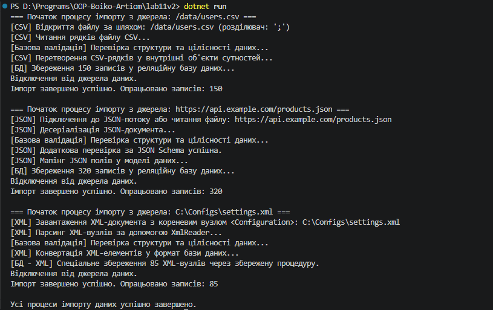

## Висновок

Під час виконання лабораторної роботи №11 було досліджено та практично застосовано патерн проєктування **Template Method** (Шаблонний метод) за допомогою абстрактних класів у мові програмування C# (.NET SDK).

На прикладі Варіанту 2 (`DataImporter`) було реалізовано:
1. Абстрактний базовий клас `DataImporter`, який визначає загальний скелет алгоритму імпорту (`Import()`), що послідовно викликає кроки: `Connect()`, `ReadData()`, `Validate()`, `Transform()`, `SaveToDatabase()`, `Disconnect()`.
2. Похідні класи `CSVImporter`, `JSONImporter` та `XMLImporter`, які реалізують обов'язкові абстрактні кроки та за потреби перевищують віртуальні методи (`Validate()`, `SaveToDatabase()`).
3. Колекцію об'єктів базового типу в методі `Main`, яка демонструє поліморфне виконання єдиного шаблонного методу для різних форматів даних.

Використання цього патерну дозволило дотриматися принципу DRY (Don't Repeat Yourself), винісши спільну послідовність дій у базовий клас, та забезпечити гнучкість при додаванні нових джерел імпорту.

