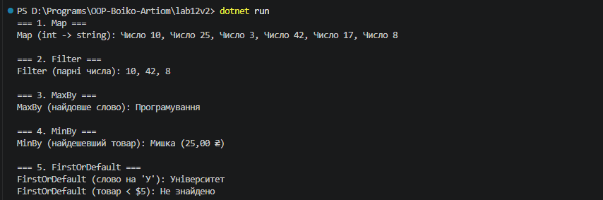

## Висновок

Під час виконання лабораторної роботи №12 було досліджено та практично застосовано Generic-методи для повторного використання логіки та делегати Func<T> i Action<T> у мові програмування C# (.NET SDK).

На прикладі Варіанту 2 (`FunctionalUtils`) було реалізовано:
1. Клас `FunctionalUtils` з 5 generic-методами вищого порядку: `Map()`, `Filter()`, `MaxBy()`, `MinBy()` та `FirstOrDefault()`.
2. Використання обмежень типів (`where TKey : IComparable<TKey>`) для методів пошуку значень за ключем (`MaxBy`, `MinBy`).
3. Демонстрацію роботи кожного методу в `Main` з використанням лямбда-виразів на різних типах даних (`int`, `string` та кастомному класі `Product`).

Використання узагальненого програмування дозволило дотриматися принципу DRY (Don't Repeat Yourself), створити гнучкий та безпечний щодо типів код для обробки колекцій без прив'язки до конкретних типів даних.

