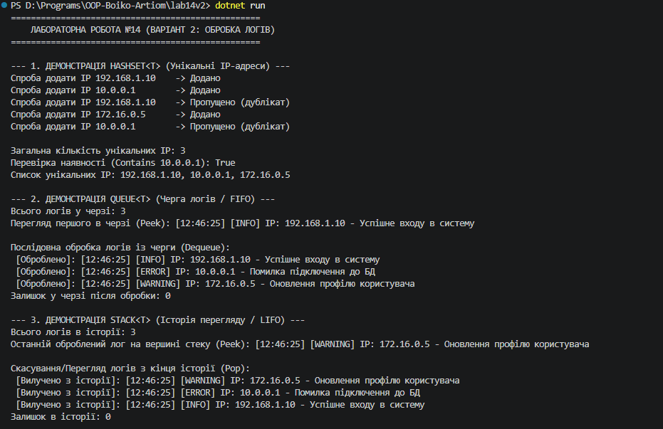

## Висновок

Під час виконання лабораторної роботи №14 було досліджено та практично застосовано спеціалізовані колекції `HashSet<T>`, `Queue<T>` та `Stack<T>` у мові програмування C# (.NET SDK).

На прикладі Варіанту 2 (Система обробки логів) було реалізовано:
1. `HashSet<string>` для збереження унікальних IP-адрес із фільтрацією дублікатів та швидкою перевіркою $O(1)$.
2. `Queue<LogEntry>` для збереження черги логів та їхньої послідовної обробки за принципом FIFO (First In, First Out).
3. `Stack<LogEntry>` для зберігання історії оброблених логів із можливістю перегляду та скасування дій за принципом LIFO (Last In, First Out).

Використання спеціалізованих колекцій дозволило оптимізувати роботу з даними, забезпечити правильний порядок обробки подій та підвищити продуктивність програми.

