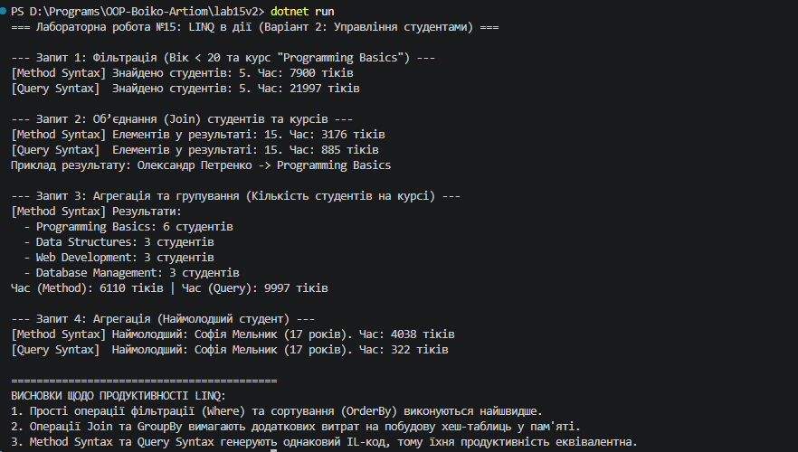

## Висновок

Під час виконання лабораторної роботи №15 було досліджено та практично застосовано технологію LINQ (Language Integrated Query) для ефективної фільтрації, об’єднання (join), групування та агрегації даних у мові програмування C# (.NET SDK).

На прикладі Варіанту 2 («Управління студентами») було реалізовано:
* **Фільтрацію (`Where`, `Any`)** для відбору студентів заданого віку та навчальних курсів із використанням як синтаксису методів, так і синтаксису запитів.
* **Об’єднання колекцій (`Join`)** для зв’язування студентів із відповідними курсами та виведення зв’язаних даних.
* **Агрегацію та групування (`GroupBy`, `Count`)** для підрахунку кількості студентів на кожному курсі.
* **Агрегатні функції (`OrderBy`, `FirstOrDefault`)** для знаходження мінімальних/максимальних значень (зокрема, наймолодшого студента).

Використання класу `System.Diagnostics.Stopwatch` дозволило виміряти час виконання запитів у процесорних тіках, а порівняння синтаксису методів і запитів показало їхню однакову продуктивність завдяки генерації ідентичного IL-коду.

