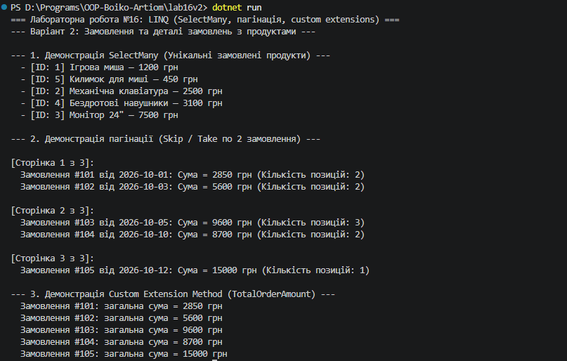

## Висновок

Під час виконання лабораторної роботи №16 було досліджено та практично застосовано просунуті оператори LINQ для роботи з вкладеними колекціями та розширення функціональності мови C# (.NET SDK).

На прикладі Варіанту 2 («Замовлення та деталі замовлень з продуктами») було реалізовано:
* **Оператор `SelectMany`** для «розгортання» вкладених колекцій (`OrderDetails`) та отримання загального плоского списку унікальних замовлених продуктів без дублікатів.
* **Механізм пагінації (`Skip`, `Take`)** для посторінкового виведення списку замовлень (по 2 замовлення на сторінку) з динамічним розрахунком кількості сторінок.
* **Власний метод розширення (Custom Extension Method)** `TotalOrderAmount()` для інтерфейсу `IEnumerable<OrderDetail>`, який інкапсулює бізнес-логіку обчислення загальної вартості позицій у замовленні.

Використання методів розширення та операторів проєктування дозволило зробити код чистим, модульним та зручним для читання.

