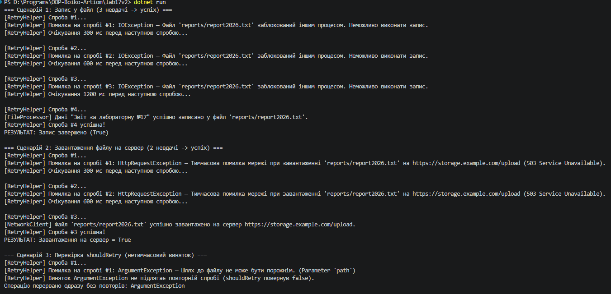

## Висновок

Під час виконання лабораторної роботи №17 було досліджено та практично застосовано механізми обробки винятків вводу/виводу й мережевих помилок, а також патерн Retry для підвищення відмовостійкості застосунків у мові C# (.NET SDK).

На прикладі Варіанту 2 («Запис у файл та завантаження на сервер») було реалізовано:
* **Узагальнений клас `RetryHelper`** з методом `ExecuteWithRetry<T>`, який забезпечує автоматичне повторення невдалих операцій та детальне логування кожної спроби.
* **Експоненційну затримку** за формулою `initialDelay * 2^(attempt - 1)` (`300 мс → 600 мс → 1200 мс`), що поступово збільшує паузу між спробами та запобігає перевантаженню диска чи сервера.
* **Вибіркову фільтрацію винятків** через делегат `shouldRetry`, який дозволяє повторювати лише тимчасові збої (`IOException`, `HttpRequestException`) та одразу переривати виконання при критичних помилках (`ArgumentException`).

Використання патерну Retry у поєднанні з експоненційною затримкою дозволило зробити взаємодію з файловою системою та мережевими ресурсами стабільною й стійкою до тимчасових збоїв.

