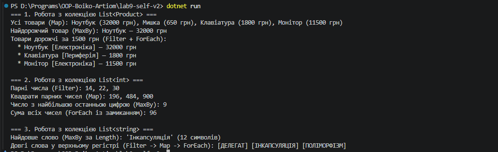

## Висновок та звіт до самостійної роботи №10

Під час виконання самостійної роботи було досліджено механізми роботи делегатів (`Func`, `Action`, `Predicate`) та лямбда-виразів у мові C# (.NET SDK) шляхом створення власного статичного класу утиліт `CollectionUtils` (`Map`, `MaxBy`, `Filter`, `ForEach`) та тестування його на колекціях `List<Product>`, `List<int>` і `List<string>`.

### 1. Чому делегати корисні для створення таких утиліт?
Делегати дозволяють **відокремити алгоритм обходу колекції від конкретної бізнес-логіки** (умови фільтрації, правила перетворення чи дії над елементом). Завдяки цьому один узагальнений метод (наприклад, `Filter<T>`) може повторно використовуватися для будь-яких типів даних і будь-яких критеріїв перевірки без дублювання циклів `foreach` по всьому проєкту.

### 2. Як лямбда-вирази спрощують виклик цих методів?
Лямбда-вирази (`p => p.Price > 1500m`) дозволяють передавати поведінку як аргумент **інлайново — безпосередньо в місці виклику**, не створюючи окремих іменованих методів-обробників чи допоміжних класів. Компілятор самостійно виводить типи параметрів (`type inference`), що робить код компактним, декларативним і легким для читання.

### 3. Порівняння власних методів із вбудованими LINQ-операторами

| Метод `CollectionUtils` | Аналог у LINQ (`System.Linq`) | Ключові відмінності |
| :--- | :--- | :--- |
| `Map<TSource, TResult>` | `Select` | `CollectionUtils.Map` використовує **негайне виконання** (одразу формує та повертає `List<TResult>` у пам'яті). `LINQ Select` працює через **відкладене виконання** (`yield return`), обчислюючи елементи лише під час ітерації. |
| `Filter<T>` | `Where` | `Filter` приймає вузькоспеціалізований делегат `Predicate<T>` і одразу матеріалізує новий список. `LINQ Where` приймає `Func<T, bool>`, підтримує ліниві обчислення та ланцюжки запитів без проміжних списків. |
| `MaxBy<T, TKey>` | `MaxBy` (з .NET 6+) | Обидва виконують негайний прохід по колекції та вимагають порівняння ключів (`IComparable<TKey>`). Вбудований LINQ-метод додатково підтримує передачу власного `IComparer<TKey>`. |
| `ForEach<T>` | `List<T>.ForEach` (немає у стандартному `IEnumerable`) | У стандартному LINQ свідомо відсутній `ForEach` для `IEnumerable<T>`, оскільки концепція LINQ базується на чистих функціях без побічних ефектів. Власний `CollectionUtils.ForEach` зручний для термінальних дій (виводу в консоль, логування). |

