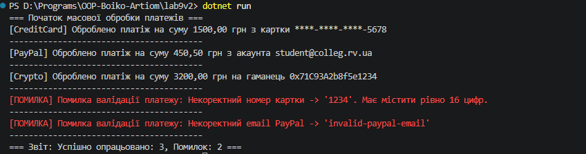

## Висновок

Під час виконання лабораторної роботи №9 було досліджено та практично застосовано принципи поліморфізму, абстрактних класів та обробки винятків (try-catch) у мові програмування C# (.NET SDK).

На прикладі ієрархії класів платежів Payment -> CreditCardPayment, PayPalPayment, CryptoPayment (Варіант 2) було реалізовано:
1. Абстрактний базовий клас Payment з поліморфними методами Process() та Validate().
2. Похідні класи, які реалізують специфічну логіку валідації та проведення платежів для кожного типу транзакцій.
3. Клас-сервіс PaymentService для масової обробки колекції платежів із безпечним перехопленням помилок за допомогою блоку try-catch.

У результаті виконання програми продемонстровано, що поліморфні виклики дозволяють гнучко обробляти різні типи платіжних систем у єдиному циклі, а механізм винятків коректно запобігає аварійному завершенню програми при передачі невалідних даних (некоректних номерів карток чи email-адрес).

Робота підтвердила переваги об'єктно-орієнтованого програмування для створення надійного, розширюваного та захищеного від помилок коду.

